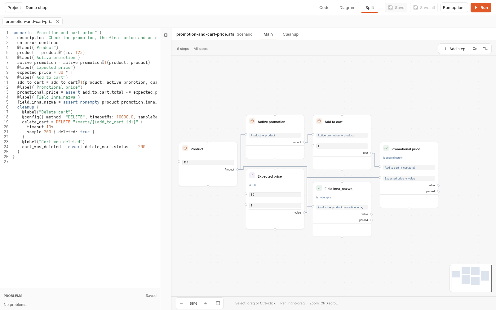
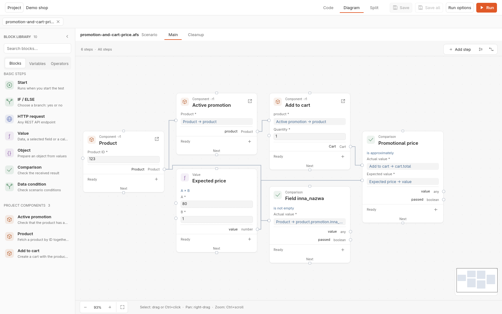
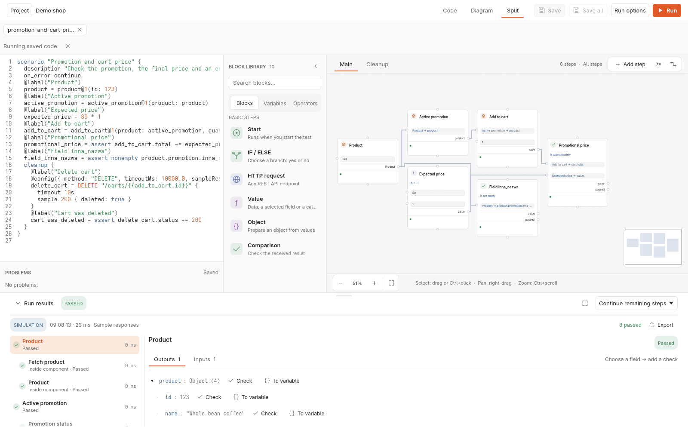
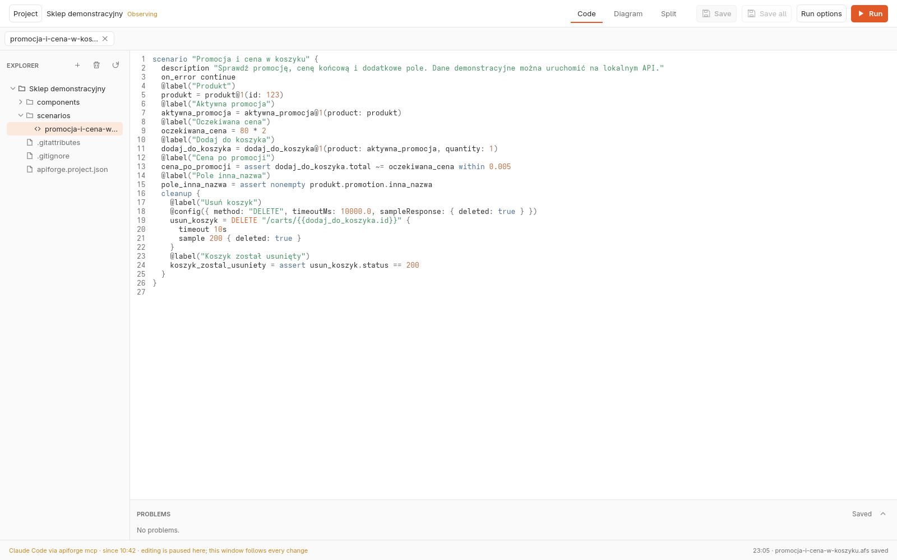

<p align="center">
  
</p>

<h1 align="center">API Forge</h1>

<p align="center">
  REST API test scenarios you can read as code and see as a diagram.
</p>

<p align="center">
  <a href="https://github.com/jakubiszon26/apiforge/actions/workflows/rust.yml"></a>
  <a href="https://github.com/jakubiszon26/apiforge/releases"></a>
</p>

API Forge is a desktop application for Linux and Windows for regression tests
of REST APIs. Each scenario is a `.afs` text file in an ordinary folder, which
Git versions like any other source, and the application shows the same
scenario as a board of blocks wired by data. Edit either one and the other
follows. It is written in Rust with [egui](https://github.com/emilk/egui).



## What it does

- **Code, Diagram and Split.** A scenario is text in the scenario language
  and, at the same time, a diagram of requests, values, checks and branches.
  Split shows both side by side; an edit in either updates the other once the
  code is valid, without losing block identity or layout. Invalid code keeps
  the last valid diagram on screen, read-only.
- **The block library.** Requests, values, objects, comparisons, data
  conditions, IF/ELSE branches and the project's own components, searchable
  and dragged onto the board, with variables and operators beside them.
  Automatic layout arranges the board and wires go around blocks.
- **Components with published revisions.** A reusable step, such as *fetch a
  product* or *add to cart*, becomes a component with typed inputs and
  outputs. A scenario calls an exact published revision (`Product@1(...)`), so
  a later change to the component never alters a scenario until it moves to
  the new revision.
- **Simulation and live requests.** *Run* simulates the scenario with the
  sample responses written into it and sends nothing. *Run live requests*
  sends real requests to the project's base URL. A live run is journalled, so
  a run interrupted by a crash is reported at the next start, and a cleanup
  phase runs after errors and cancellation too.
- **Run results with checks.** Every step's inputs, outputs, request and
  response, with secrets masked. Any field of a response becomes a new check
  or a variable in one click.
- **Safe local storage.** Atomic saves, recovery of unsaved work after a
  crash, one writer per project, and a review of conflicts when a file
  changes outside the application.





## Working with an AI agent over MCP

`apiforge mcp` serves a folder project to a model over the
[Model Context Protocol](https://modelcontextprotocol.io). The agent reads,
checks, simulates and edits scenarios through API Forge's own project
session — the same files and bytes the window writes — while the window stays
open beside it.

On Windows/WSL, run the window and MCP server on the same side; a Windows
window with Linux MCP (or the reverse) is unsupported, including projects on
`/mnt/<drive>/`.

1. **Install** API Forge from [Releases](#install) (on Linux, the `.tar.gz`
   holds the `apiforge` command line; the AppImage is the window only).
2. **Register the server** in the project folder:

   ```bash
   claude mcp add apiforge -- /path/to/apiforge mcp
   ```

   or check in a `.mcp.json` at the project root:

   ```json
   {
     "mcpServers": {
       "apiforge": { "command": "/path/to/apiforge", "args": ["mcp"] }
     }
   }
   ```

3. **Let the agent work.** In Claude Code the tools appear as
   `mcp__apiforge__<tool>`:

   | Tools | What the agent can do |
   | --- | --- |
   | `project_overview`, `read_source`, `check`, `print`, `language_reference` | Learn the project and the language; read every source with its diagnostics, line, column and version |
   | `check_text` | Check a proposed text before saving anything |
   | `run` | Simulate a scenario or a component; with permission, run it live |
   | `write_source`, `create_document`, `finish_editing` | Save a source or register a new one, only when the text is valid and only over the version it read |
   | `publish` | Turn a component into its next immutable revision, the same transaction as *Publish* in the window |

4. **Watch in the window.** While the agent holds the project, the open
   window observes: editing pauses there, the bottom bar names the agent, and
   every change the agent commits appears within two seconds, keeping your
   place. A window with nothing unsaved hands the project over when the agent
   first writes; *Take back* in the bottom bar returns it to you, and when
   the agent finishes the window takes the project back by itself.

5. **Live requests stay yours.** A model cannot allow live requests: the
   person starts the server with `--allow-live`. Secrets come from
   `APIFORGE_SECRET_<NAME>` in the server's environment or a `--secrets`
   file, and no secret value leaves the server in any result, error or log.

Coming in the next releases: a per-project switch for live requests in the
window, a prompt to save and hand over when the window has unsaved work, and
the agent's run status in the bottom bar. The full contract is in the
[development guide](docs/development.md#mcp-server).



## Where it is useful

- **Regression scenarios for a REST API.** Describe a business flow once —
  look up a product, check its promotion, add it to a cart, check the total,
  delete the cart — and run it after every change of the API.
- **Contract checks between services.** The project's data contracts and
  comparisons on response fields catch a changed or missing field before a
  consumer does.
- **Onboarding to an API.** A scenario's diagram shows which call feeds which,
  and simulation with sample responses runs it without a server.
- **An agent drafts, a person reviews.** The agent writes and fixes scenarios
  over MCP and checks them before saving, while the person watches each change
  in the window and decides when to run live.
- **Runs in CI.** `apiforge run --folder <project> --scenario <path> --json`
  runs a saved scenario from the command line: exit code 0 when it passed, 1
  when it did not, 2 for wrong arguments.

## Install

Every [release](https://github.com/jakubiszon26/apiforge/releases) has four
assets:

| Asset | Contents |
| --- | --- |
| `apiforge-desktop-<version>-x86_64.AppImage` | The window for Linux x86_64 |
| `apiforge-<version>-x86_64-unknown-linux-gnu.tar.gz` | `apiforge-desktop` and the `apiforge` command line for Linux x86_64 (glibc 2.35 or newer) |
| `apiforge-<version>-x86_64-pc-windows-msvc.zip` | `apiforge-desktop.exe` and `apiforge.exe` for Windows x86_64 |
| `SHA256SUMS.txt` | The SHA-256 of each asset, for `sha256sum -c` |

On Linux, make the AppImage executable and start it:

```bash
chmod +x apiforge-desktop-*-x86_64.AppImage
./apiforge-desktop-*-x86_64.AppImage
```

On Windows, extract the ZIP and start `apiforge-desktop.exe`. The binaries are
not signed, so SmartScreen may warn on the first start (*More info → Run
anyway*). Releases are pre-releases for now. `apiforge --version` and
`apiforge-desktop --version` print the version; `CLAUDE-CODE.md` in each
archive repeats the MCP setup.

### Build from source

Rust 1.99.0 is pinned in `rust-toolchain.toml`. On Linux an X11 or Wayland
session and the system libraries listed in the
[CI workflow](.github/workflows/rust.yml) are needed.

```bash
cargo run -p apiforge-desktop --locked                # the window
cargo run -p apiforge-cli --locked -- --help          # the command line
cargo run -p apiforge-demo-api --locked               # the demo API, http://127.0.0.1:4318/demo
```

The first start opens demo projects that run against the small local demo API.
The [development guide](docs/development.md) covers the toolchain, the
verification every change passes and how releases are made.

## The scenario language

```text
scenario "Checkout" {
  param quantity = 2
  begin = start
  @after(begin)
  products = GET "/products" {
    sample 200 { items: [{ id: "p-1", price: 12.5 }] }
  }
  status_ok = assert products.status == 200
  first = products.body.items[0]
  @after(status_ok)
  order = POST "/orders" {
    body { productId: first.id, quantity: param.quantity }
  }
}
```

`apiforge fmt`, `check`, `print`, `apply` and `run` format, validate, print
and execute scenarios from the command line. The grammar and the round-trip
contract are in [ADR 0005](docs/decisions/0005-scenario-language.md); the
reference given to models is [docs/language/reference.md](docs/language/reference.md).

## Documentation

- [Folder projects](docs/folder-projects.md): the folder, the window, saving,
  runs, keyboard and Git.
- [Development guide](docs/development.md): toolchain, verification, the MCP
  server, releases.
- [Architecture decisions](docs/decisions) and the [roadmap](docs/roadmap.md).
- [Backlog](docs/backlog.md) and the
  [development process](docs/process/README.md).

## Limitations

- Single user and local only; no collaboration and no hosted runner.
- Acyclic graphs executed in order; no loops, case matrices or scripting.
- JSON and text bodies; no multipart, automatic OAuth, retries or redirects.
- Requests time out after 10 seconds unless configured (at most 60),
  responses are limited to 2 MiB, the main phase to 120 seconds and cleanup
  to 10 seconds.
- Cancellation cannot undo what the tested API already did, and a crash
  cannot guarantee cleanup; the run journal reports what such a run may have
  performed.
- The legacy JSON workspace (`--legacy`) is retired and will be removed once
  the folder mode covers its
  [parity list](docs/tickets/KTLO-06.md#the-parity-list).

## License

GPL-3.0-or-later © The API Forge contributors: the GNU General Public License,
version 3 or any later version, in [LICENSE](LICENSE). The bundled fonts keep
their own licences, in `licenses/` of each release archive and in
[crates/apiforge-desktop/assets/fonts](crates/apiforge-desktop/assets/fonts).
Contributions are signed off under the Developer Certificate of Origin; see
[CONTRIBUTING.md](CONTRIBUTING.md).
