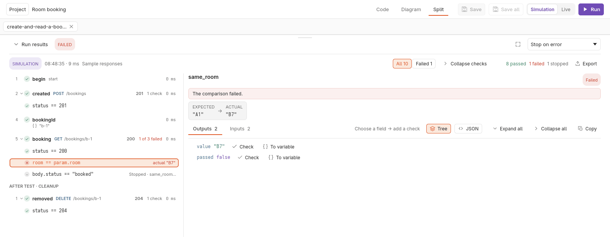

<p align="center">
  
</p>

<h1 align="center">API Forge</h1>

<p align="center">
  REST API test scenarios you can read as code and see as a diagram.
</p>

<p align="center">
  <a href="https://github.com/jakubiszon26/apiforge/actions/workflows/rust.yml"></a>
  <a href="https://github.com/jakubiszon26/apiforge/releases"></a>
</p>

API Forge is a desktop application for Linux and Windows for regression tests
of REST APIs. A test is a scenario: a `.afs` text file in an ordinary folder,
versioned by Git like any other source. The window shows the same file as a
board of blocks wired by data; an edit on either side changes the other. The
language is small on purpose, so that a person, the window and an AI model
can all write the same file and read each other's changes. It is written in
Rust with [egui](https://github.com/emilk/egui).


The scenario in the picture is the example of the next section, run as a
simulation.

## What it is

- **One document, three views.** *Code*, *Diagram* and *Split* show one
  `.afs` file. A statement is a block; a value one statement reads from
  another is a wire. Invalid code keeps the last valid board on screen,
  read-only, until the text is valid again.
- **Runs without a server, or against one.** *Simulation* answers every
  request with the sample response written beside it and sends nothing.
  *Live* sends real requests to the project's base URL. The switch is beside
  the Run button.
- **Run results that lead back to the test.** A request is listed with its
  checks under it; a failed check shows what it expected and what it got. A
  field of a response becomes a check or a variable from its row.
- **Components with published revisions.** A reusable step has typed inputs
  and outputs. A scenario calls an exact revision, `product@1(...)`, so a
  later change to the component does not alter a scenario until its call is
  moved to the new revision.
- **A command line and an MCP server.** `apiforge check`, `fmt`, `print`,
  `apply`, `fix` and `run` work on the same files; `apiforge mcp` gives them
  to an AI agent ([below](#working-with-an-agent-over-mcp)).



## The `.afs` language

```afs
scenario "Create and read a booking" {
  param room = "A1"
  begin = start
  created = POST "/bookings" {
    body { room: param.room, guests: 2 }
    sample 201 { id: "b-1", room: "A1", status: "booked" }
  }
  accepted = assert created.status == 201
  var bookingId = created.body.id
  booking = GET "/bookings/{{bookingId}}" {
    sample 200 { id: "b-1", room: "A1", status: "booked" }
  }
  found = assert booking.status == 200
  same_room = assert booking.body.room == param.room
  booked = assert booking.body.status == "booked"
  cleanup {
    removed = DELETE "/bookings/{{bookingId}}" {
      sample 204 {}
    }
    gone = assert removed.status == 204
  }
}
```

A simulated run from the command line:

```console
$ apiforge run --folder . --scenario scenarios/booking.afs
       ok  begin
       ok  created
       ok  accepted
       ok  bookingId
       ok  booking
       ok  found
       ok  same_room
       ok  booked
       ok  removed
       ok  gone
Passed
```

The exit code is 0 when the run passed, 1 when it did not and 2 for wrong
arguments; `--json` prints every step with its inputs, its outputs and the
request it sent; `--live` sends the requests.

### What it can do today

- **Requests**: `GET`, `HEAD`, `POST`, `PUT`, `PATCH`, `DELETE`, `OPTIONS`
  with headers, query, a JSON or text body, a timeout, and a `sample`
  response for simulation. A request's `status`, `body`, `headers` and
  `duration` are values the following statements read.
- **Order by position.** Steps run top to bottom as written. A check or a
  value is not a step: it runs as soon as what it reads exists.
- **Checks**: `assert` with `==`, `!=`, `<`, `>`, `<=`, `>=`, a numeric
  tolerance (`~= … within`), `contains`, a type (`is "number"`), `exists`,
  `nonempty`, and any Boolean expression; `condition all { … }` and
  `condition any { … }` guard the data later steps read.
- **Values and expressions**: literals, objects, lists, string templates
  (`"/bookings/{{bookingId}}"`), arithmetic, comparison and logic, and built-in
  functions such as `round`, `length`, `concat`, `uuid` and `random`. `var`
  names a value several steps read.
- **Branches**: `if … { } else { }` on one predicate.
- **Cleanup**: a `cleanup { }` block runs after the main flow whatever
  happened in it. A cleanup step whose input never came into being is
  skipped, and the ones after it still run.
- **Failure policy**: `on_error stop` (the default) stops the main flow at
  the first failure; `on_error continue` goes on and reports every failure,
  holding back only a step whose input does not exist.
- **Parameters, environment and secrets**: `param` with a default,
  `env.name` for values and secrets the project holds. A secret's value is
  never written into a file.
- **Components**: `input`, `export` and a call by handle and revision.
- **Response contracts**: a request can name a contract of the project that
  describes its response body.
- **One printed form**: `apiforge fmt` writes the one canonical layout and
  keeps every comment; `fmt --check` fails on a file that is not in it.
- **Diagnostics before a run**: `apiforge check` reports each problem with
  its file, line, column and message. Over MCP the same diagnostics carry,
  for some problems, a fix: the replacement text and the range it goes to.

The whole language is on one page, [docs/language/reference.md](docs/language/reference.md),
and a test of the repository parses every example on it. The grammar and the
round trip between text and board are decided in
[ADR 0005](docs/decisions/0005-scenario-language.md); what runs after a
failure in [ADR 0015](docs/decisions/0015-run-after-an-error.md).

### What it cannot do yet

No loops, no table of cases, no waiting or retrying, no user-defined
functions, no imports and one scenario per file. `&&` and `||` evaluate both
sides, so a guard does not protect the read after it. A check that reads a
field the response lacks ends as an error, not as a failed check. Headers
are written in every request. Bodies are JSON or text: no multipart upload.
There is no automatic OAuth flow, and a redirect is reported as an error,
not followed. `check` does not know the shape of a response: a misspelt field
name passes it and is found by the run.

## Why this helps a language model

A model can already write API tests in JavaScript; with
[Playwright](https://playwright.dev/docs/api-testing) it needs no special
language. The same test both ways, first as above and then with Playwright's
`request` fixture:

```ts
import { test, expect } from '@playwright/test';

test('create and read a booking', async ({ request }) => {
  const room = 'A1';
  const created = await request.post('/bookings', { data: { room, guests: 2 } });
  expect(created.status()).toBe(201);
  const { id } = await created.json();
  try {
    const booking = await request.get(`/bookings/${id}`);
    expect(booking.status()).toBe(200);
    expect(await booking.json()).toMatchObject({ room, status: 'booked' });
  } finally {
    const removed = await request.delete(`/bookings/${id}`);
    expect(removed.status()).toBe(204);
  }
});
```

Both were run against one local test server, passing and with a wrong room
in the answer; in both the booking was deleted after the failure (Playwright
1.65.1, API Forge at this commit). The Playwright file is the shorter one:
16 lines and 594 characters against 22 and 668 (`wc -l -m`), beside a
five-line `playwright.config.ts` for the base URL. Three of the `.afs` lines
are the sample responses, which the Playwright test has no counterpart for.
The case for `.afs` rests on what the smaller language rules out and what
its tools can promise because of that, not on brevity:

- **A scenario can only send requests, compute and check.** There is no
  `import`, no file or process access and no function to define. A reviewer
  of a model's scenario reads requests and checks, not a program; a
  Playwright test is a Node.js program and can do whatever one can. That is
  also the language's limit, as the next list says. A request may name any
  absolute URL, not only the project's API.
- **Wrong text is reported before anything runs, in a form a model can
  apply.** The server's `check_text` takes a proposed text, saves nothing and
  answers with diagnostics: line, column, message and, where one exists, the
  replacement. A missing `begin = start`, a missing brace, a type written
  without quotes and a component call without its revision each come back
  with their fix; an unknown name comes back with its position. TypeScript
  has a compiler and quick fixes too; here, in addition, the server's write
  tools refuse to save a text that has an error (`invalid_text`).
- **A run that sends nothing.** The sample responses are part of the file,
  so a model can run what it wrote and read each step's result without a
  server, credentials or permission. Playwright documents
  [mocking for a page's network traffic](https://playwright.dev/docs/mock);
  for the `request` fixture the test needs a server or a mock server. The
  limit is plain: a simulation proves the scenario against samples its
  author wrote, not against the API.
- **Sending real requests is a separate permission a model cannot give
  itself.** Over MCP a live run answers `live_disabled` until the person
  allows it in the window or starts the server with `--allow-live`.
- **Order and cleanup are part of the language.** There is no `await` to
  forget and no shared variable assigned in one hook and read in another: a
  statement names what it reads. Cleanup is a block, not a choice between
  `try`/`finally`, [hooks](https://playwright.dev/docs/api/class-test#test-after-each)
  and [fixtures](https://playwright.dev/docs/test-fixtures#creating-a-fixture),
  and a cleanup step with nothing to clean is skipped by rule.
- **One way to write it, so edits are small.** There is one canonical layout,
  and an edit on the board rewrites only the statements it changes. A change
  made by a model shows in a diff as the lines that changed.
- **A person reviews the board, not only the text.** What a model wrote is
  the diagram the window draws: which request feeds which, and which checks
  stand under each.
- **The reference travels with the tool.** `language_reference` returns the
  page linked above (848 lines at this commit) with the diagnostics a model
  will meet and what to do about each.

### Where Playwright and JavaScript are the better choice

- **Anything in a browser.** Playwright is "an end-to-end test framework for
  modern web apps" ([its documentation](https://playwright.dev/docs/intro));
  API Forge tests REST APIs and nothing else.
- **Arbitrary logic.** Loops, retries, polling, a computed set of cases, a
  signature or a token built by a library: ordinary code there, absent here
  ([what `.afs` cannot do yet](#what-it-cannot-do-yet)).
- **The ecosystem.** Every npm package, reporters,
  [steps in the report](https://playwright.dev/docs/api/class-test#test-step),
  [soft assertions](https://playwright.dev/docs/test-assertions#soft-assertions),
  parallel workers, CI integrations and years of answered questions.
  Playwright has its own [MCP server](https://playwright.dev/docs/getting-started-mcp)
  and [test agents](https://playwright.dev/docs/test-agents), built for
  browser tests.
- **What models already know.** A model has seen far more JavaScript and
  Playwright than `.afs`, which it has most likely never seen: it writes the
  first from memory and the second from the reference it has to read first.
- **Evidence.** The points above are properties of the design, each checked
  on the current build. No benchmark of models writing `.afs` against models
  writing Playwright tests has been run.

## Planned

Planned, not promised, and without dates. Each item is accepted into scope or
decided on its issue; its design can still change, and nothing in this list
works today.

The language ([LANG milestone](https://github.com/jakubiszon26/apiforge/milestone/1)):

- A loop: `for` over a list as a block, with `collect` and `count` as what
  it gives back ([#352](https://github.com/jakubiszon26/apiforge/issues/352),
  shape decided in [#413](https://github.com/jakubiszon26/apiforge/issues/413)).
- Waiting for an asynchronous state: `retry until` on one request
  ([#212](https://github.com/jakubiszon26/apiforge/issues/212)).
- A table of cases: one request written once and run for every row
  ([#470](https://github.com/jakubiszon26/apiforge/issues/470)).
- A check on a missing field fails instead of ending as an error, and `??`
  says what stands in for a missing value
  ([#127](https://github.com/jakubiszon26/apiforge/issues/127)).
- `&&` and `||` short-circuit
  ([#589](https://github.com/jakubiszon26/apiforge/issues/589), designed
  with #127).
- One check for several fields, `matches { … }`, and a check that needs no
  invented name ([#472](https://github.com/jakubiszon26/apiforge/issues/472)).
- Headers and authorization stated once for a scenario
  ([#471](https://github.com/jakubiszon26/apiforge/issues/471)).
- A request's argument read as `arg.name`
  ([#592](https://github.com/jakubiszon26/apiforge/issues/592)).

The window ([REQ milestone](https://github.com/jakubiszon26/apiforge/milestone/3)):

- *Steps*: the scenario as a numbered list of steps with their checks, a
  second presentation beside the board
  ([#456](https://github.com/jakubiszon26/apiforge/issues/456),
  [#457](https://github.com/jakubiszon26/apiforge/issues/457)).
- The selected request and its response side by side
  ([#458](https://github.com/jakubiszon26/apiforge/issues/458)).
- *Run to here* and *Send this request alone*
  ([#461](https://github.com/jakubiszon26/apiforge/issues/461),
  [#462](https://github.com/jakubiszon26/apiforge/issues/462)).
- Headers as a table and authorization chosen from a list
  ([#460](https://github.com/jakubiszon26/apiforge/issues/460)).

## Working with an agent over MCP

`apiforge mcp` serves a folder project to a model over the
[Model Context Protocol](https://modelcontextprotocol.io). The agent works
through API Forge's own project session, on the same files the window
writes, while the window stays open beside it.

1. **Install** API Forge from [Releases](#install) (on Linux, the `.tar.gz`
   holds the `apiforge` command line; the AppImage is the window only).
2. **Register the server** in the project folder:

   ```bash
   claude mcp add apiforge -- /path/to/apiforge mcp
   ```

   or check in a `.mcp.json` at the project root:

   ```json
   {
     "mcpServers": {
       "apiforge": { "command": "/path/to/apiforge", "args": ["mcp"] }
     }
   }
   ```

3. **The tools.** In Claude Code they appear as `mcp__apiforge__<tool>`:

   | Tools | What the agent can do |
   | --- | --- |
   | `project_overview`, `read_source`, `check`, `print`, `language_reference` | Learn the project and the language; read every source with its diagnostics, line, column and hash |
   | `check_text` | Check a proposed text before saving anything |
   | `run` | Simulate a scenario or a component; with permission, run it live |
   | `write_source`, `create_document`, `finish_editing` | Save a source or register a new one, only when the text has no error and only over the version it read (`stale_source` otherwise) |
   | `publish` | Turn a component into its next immutable revision, the same transaction as *Publish* in the window |

4. **Watch in the window.** A window with nothing unsaved hands the project
   over when the agent first writes. While the agent holds it, editing
   pauses in the window, the bottom bar names the agent and each change the
   agent saves appears on the board. *Take back* in the bottom bar returns
   the project; when the agent calls `finish_editing` the window takes it
   back by itself. A window with unsaved work asks the person: *Save all
   and hand over*, or *Keep editing*, which refuses the agent's write.
5. **Live requests stay yours.** *Project settings → Agent* has *Allow the
   MCP agent to send live requests*, off by default. Without a window the
   person starts the server with `--allow-live`. Secrets come from
   `APIFORGE_SECRET_<NAME>` in the server's environment or a `--secrets`
   file, and a text that contains a known secret's value is refused
   (`secret_in_text`).

On Windows with WSL, run the window and the MCP server on the same side; a
Windows window with a Linux server (or the reverse) is unsupported. The full
contract is in the [development guide](docs/development.md#mcp-server).

## Install

Every [release](https://github.com/jakubiszon26/apiforge/releases) has four
assets:

| Asset | Contents |
| --- | --- |
| `apiforge-desktop-<version>-x86_64.AppImage` | The window for Linux x86_64 |
| `apiforge-<version>-x86_64-unknown-linux-gnu.tar.gz` | `apiforge-desktop` and the `apiforge` command line for Linux x86_64 (glibc 2.35 or newer) |
| `apiforge-<version>-x86_64-pc-windows-msvc.zip` | `apiforge-desktop.exe` and `apiforge.exe` for Windows x86_64 |
| `SHA256SUMS.txt` | The SHA-256 of each asset, for `sha256sum -c` |

On Linux, make the AppImage executable and start it:

```bash
chmod +x apiforge-desktop-*-x86_64.AppImage
./apiforge-desktop-*-x86_64.AppImage
```

On Windows, extract the ZIP and start `apiforge-desktop.exe`. The binaries are
not signed, so SmartScreen may warn on the first start (*More info → Run
anyway*). Releases are pre-releases for now. `apiforge --version` and
`apiforge-desktop --version` print the version; `CLAUDE-CODE.md` in each
archive repeats the MCP setup.

### Build from source

Rust 1.99.0 is pinned in `rust-toolchain.toml`. On Linux an X11 or Wayland
session and the system libraries listed in the
[CI workflow](.github/workflows/rust.yml) are needed.

```bash
cargo run -p apiforge-desktop --locked                # the window
cargo run -p apiforge-cli --locked -- --help          # the command line
cargo run -p apiforge-demo-api --locked               # the demo API, http://127.0.0.1:4318/demo
```

The first start, in an empty data directory, opens *Demo shop* on the board of
its scenario *Buy coffee on promotion*: a product looked up through the
component `product`, a cart created and checked, an `if` on the promotion and
a cleanup that deletes the cart. A second scenario, *The cart refuses bad
orders*, sends three orders the shop must refuse under `on_error continue`.
Both run as a simulation, or live against the small local demo API. A data
directory that already holds a project opens that project as it is. The
[development guide](docs/development.md) covers the toolchain, the
verification every change passes and how releases are made.

## Upgrading a project from 0.1.0

In 0.1.0 steps were ordered with `@after`; since 0.2.0 they run in the order
written. A 0.1.0 project opens and can be edited but does not run until
`apiforge fix --folder <project>` has converted it. The command converts
every source and the project file in one step, or writes nothing and lists,
file by file and line by line, what to change by hand; `--check` prints the
same report without writing. The conversion is done from the command line
only, and 0.1.0 cannot open a converted project. The
[release notes](https://github.com/jakubiszon26/apiforge/releases) list what
each version changed.

## Documentation

- [The language reference](docs/language/reference.md), the page given to
  models.
- [Folder projects](docs/folder-projects.md): the folder, the window, saving,
  runs, keyboard and Git.
- [Development guide](docs/development.md): toolchain, verification, the MCP
  server, releases.
- [Architecture decisions](docs/decisions) and the [roadmap](docs/roadmap.md).
- [Backlog](docs/backlog.md) and the
  [development process](docs/process/README.md).

## Limitations

- Single user and local only; no collaboration and no hosted runner.
- The limits of the language are listed [above](#what-it-cannot-do-yet).
- Requests time out after 10 seconds unless configured (at most 60),
  responses are limited to 2 MiB, the main phase to 120 seconds and cleanup
  to 10 seconds.
- Cancellation cannot undo what the tested API already did, and a crash
  cannot guarantee cleanup; the run journal reports what such a run may have
  performed.
- The legacy JSON workspace (`--legacy`) is retired and will be removed once
  the folder mode covers its
  [parity list](docs/tickets/KTLO-06.md#the-parity-list).

## License

GPL-3.0-or-later © The API Forge contributors: the GNU General Public License,
version 3 or any later version, in [LICENSE](LICENSE). The bundled fonts keep
their own licences, in `licenses/` of each release archive and in
[crates/apiforge-desktop/assets/fonts](crates/apiforge-desktop/assets/fonts).
`licenses/THIRD-PARTY-NOTICES.md` in each package names every Rust crate
compiled into the binaries and the fonts egui embeds, with their versions and
licence texts.
Contributions are signed off under the Developer Certificate of Origin; see
[CONTRIBUTING.md](CONTRIBUTING.md).
