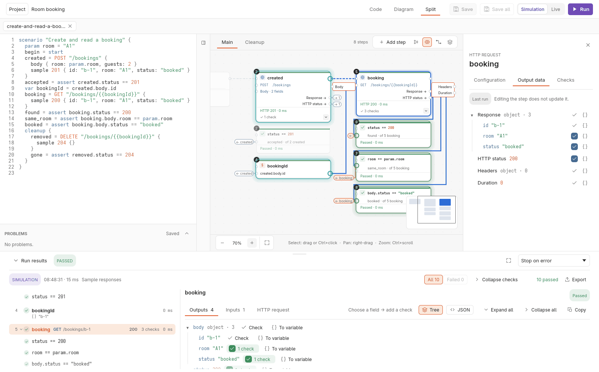
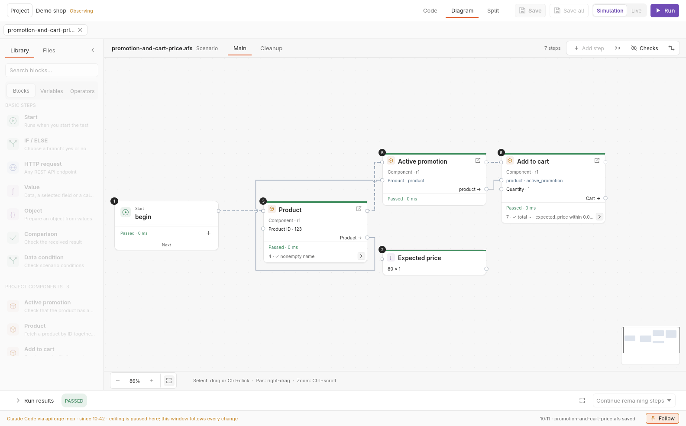

<p align="center">
  
</p>

<h1 align="center">API Forge</h1>

<p align="center">
  REST API test scenarios you can read as code and see as a diagram.
</p>

<p align="center">
  <a href="https://github.com/jakubiszon26/apiforge/actions/workflows/rust.yml"></a>
  <a href="https://github.com/jakubiszon26/apiforge/releases"></a>
</p>

API Forge is a desktop application for Linux and Windows for regression tests
of REST APIs. A test is a scenario: a `.afs` text file in an ordinary folder,
versioned by Git like any other source. The window shows the same file as a
board of blocks wired by data; an edit on either side changes the other. The
language is small on purpose, so that a person, the window and an AI model
can all write the same file and read each other's changes. It is written in
Rust with [egui](https://github.com/emilk/egui).



## What it is

- **One document, three views.** *Code*, *Diagram* and *Split* show one
  `.afs` file. A statement is a block; a value one statement reads from
  another is a wire. Invalid code keeps the last valid board on screen,
  read-only.
- **Simulation and live runs.** *Simulation* answers every request with the
  sample response written beside it and sends nothing; *Live* sends the
  requests. The switch is beside the Run button.
- **Run results that lead back to the test.** A request is listed with its
  checks under it; a failed check shows what it expected and what it got. A
  field of a response becomes a check or a variable from its row.
- **Components with published revisions.** A scenario calls an exact
  revision of a reusable step, `product@1(...)`; a later change to the
  component does not alter the scenario until its call is moved.
- **A command line and an MCP server** over the same files:
  `apiforge check`, `fmt`, `print`, `apply`, `fix`, `run` and `mcp`.


## The `.afs` language

```afs
scenario "Create and read a booking" {
  param room = "A1"
  begin = start
  created = POST "/bookings" {
    body { room: param.room, guests: 2 }
    sample 201 { id: "b-1", room: "A1", status: "booked" }
  }
  accepted = assert created.status == 201
  var bookingId = created.body.id
  booking = GET "/bookings/{{bookingId}}" {
    sample 200 { id: "b-1", room: "A1", status: "booked" }
  }
  found = assert booking.status == 200
  same_room = assert booking.body.room == param.room
  booked = assert booking.body.status == "booked"
  cleanup {
    removed = DELETE "/bookings/{{bookingId}}" {
      sample 204 {}
    }
    gone = assert removed.status == 204
  }
}
```

`apiforge run --folder . --scenario scenarios/booking.afs` simulates it and
prints `ok` for each of its ten statements, then `Passed`. `--live` sends the
requests; `--json` prints every statement's inputs and outputs and each
request sent. The exit code is 0 when the run passed, 1 when it did not and
2 for wrong arguments.

### What it can do today

- **Requests**: `GET`, `HEAD`, `POST`, `PUT`, `PATCH`, `DELETE`, `OPTIONS`
  with headers, query, a JSON or text body, a timeout and a `sample`
  response. A path is joined to the project's base URL; an absolute URL is
  sent as written. A request's `status`, `body`, `headers` and `duration`
  are values the following statements read.
- **Order by position.** The steps (`start`, requests, component calls and
  `if`) run top to bottom as written. Checks and values are placed by what
  they read: each runs as soon as its inputs exist, and a run lists it with
  its result like a step.
- **Checks**: `assert` with `==`, `!=`, `<`, `>`, `<=`, `>=`, a numeric
  tolerance (`~= … within`), `contains`, a type (`is "number"`), `exists`,
  `nonempty`, and any Boolean expression; `condition all { … }` and
  `condition any { … }` guard the data later steps read.
- **Values and expressions**: literals, objects, lists, string templates
  (`"/bookings/{{bookingId}}"`), arithmetic, comparison and logic, and
  built-in functions such as `round`, `length`, `concat`, `uuid` and
  `random`. `var` names a value several steps read.
- **Branches**: `if … { } else { }` on a check or any Boolean expression.
- **Cleanup**: a `cleanup { }` block runs after the main flow whatever
  happened in it. A cleanup step whose input never came into being is
  skipped, and the ones after it still run.
- **Failure policy**: `on_error stop` (the default) stops the main flow at
  the first failure; `on_error continue` goes on and reports every failure,
  holding back only a step whose input does not exist.
- **Parameters, environment and secrets**: `param` with a default,
  `env.name` for values and secrets the project holds. A secret's value is
  never written into a file.
- **Components**: `input`, `export` and a call by handle and revision.
- **Response contracts**: a request can name a contract of the project that
  describes its response body.
- **One printed form**: `apiforge fmt` writes the one canonical layout and
  keeps every comment; `fmt --check` fails on a file that is not in it.
- **Diagnostics before a run**: `apiforge check` reports each problem with
  its file, line, column and message.

The whole language is on one page,
[docs/language/reference.md](docs/language/reference.md) (848 lines), and a
test of the repository parses every example on it. The grammar and the round
trip between text and board are decided in
[ADR 0005](docs/decisions/0005-scenario-language.md); what runs after a
failure in [ADR 0015](docs/decisions/0015-run-after-an-error.md).

### What it cannot do yet

No loops, no table of cases, no waiting or retrying, no user-defined
functions, no imports and one scenario per file. `&&` and `||` evaluate both
sides, so a guard does not protect the read after it. A check that reads a
field the response lacks ends as an error, not as a failed check. There are
no shared headers: each request that needs a header writes it. Bodies are
JSON or text: no multipart upload. There is no automatic OAuth flow, and a
redirect is reported as an error, not followed. `check` does not know the
shape of a response: a misspelt field name passes it and is found by the
run.

## Why it suits a language model

A model can already write API tests in JavaScript or TypeScript; with
[Playwright](https://playwright.dev/docs/api-testing) it needs no special
language. The scenario above as a Playwright test, with the `request`
fixture:

```ts
import { test, expect } from '@playwright/test';

test('create and read a booking', async ({ request }) => {
  const room = 'A1';
  const created = await request.post('/bookings', { data: { room, guests: 2 } });
  expect(created.status()).toBe(201);
  const { id } = await created.json();
  try {
    const booking = await request.get(`/bookings/${id}`);
    expect(booking.status()).toBe(200);
    expect(await booking.json()).toMatchObject({ room, status: 'booked' });
  } finally {
    const removed = await request.delete(`/bookings/${id}`);
    expect(removed.status()).toBe(204);
  }
});
```

Both were run against one local test server, passing and with a wrong room
in the answer, and both deleted the booking after the failure (Playwright
1.65.1, API Forge at this commit). The Playwright test is the shorter one:
16 lines and 594 characters against 22 and 668 (`wc -l -m`); each also has
a project file for the base URL, `playwright.config.ts` there and
`apiforge.project.json` here. Three of the `.afs` lines are the sample
responses. The case for `.afs` rests on what a small language and its own
tools can promise to a model and to the person beside it, not on brevity:

1. **A run that sends nothing, and a live run only the person allows.** The
   sample responses are part of the file, so a model runs what it wrote
   without a server or credentials. Over MCP a live run answers
   `live_disabled` until the person allows it in the window or starts the
   server with `--allow-live`; a model cannot allow it. Playwright documents
   [mocking for a page's traffic](https://playwright.dev/docs/mock); a test
   with the `request` fixture needs a server or a mock server. The limit: a
   simulation proves the scenario against samples its author wrote, not
   against the API.
2. **A result sized for a context window.** The server's `run` answers with
   one status per statement and, for a failed comparison, the expected and
   the actual value, not with a terminal log. A statement's outputs above
   4 KiB are left out with their size, and a result above 2 MiB is the error
   `result_too_large`.
3. **Secret values do not reach the model.** The project lists secret names
   only; a run's report shows `[REDACTED]` in their place; a text that
   contains a known secret's value is refused (`secret_in_text`). A test
   that is a program can print its environment.
4. **The model and the person cannot overwrite each other.** A write names
   the hash of the text it read and is refused when the file has changed
   (`stale_source`); a text with an error is not saved (`invalid_text`); the
   open window hands the project over, watches the agent's changes and can
   take it back.
5. **Cleanup and live runs are accounted for.** Cleanup is a block of the
   language. When a check fails and the cleanup fails too, the run reports
   both; in the `try`/`finally` above the cleanup's error replaces the
   check's (a Playwright
   [fixture](https://playwright.dev/docs/test-fixtures#creating-a-fixture)
   reports both; tried on 1.65.1). Each live request is written to the
   project's run journal before it is sent, the result marks every step that
   may have reached the API, a cancelled run still runs its cleanup, and the
   next run lists what an interrupted one left behind.
6. **A scenario can only send requests, compute and check.** There is no
   `import`, no file or process access and no function to define, so a
   reviewer reads requests and checks, not a program. A request may still
   name any URL, which is why live runs need the permission of point 1.
7. **Wrong text comes back with its position, sometimes with its fix.**
   `check_text` takes a proposed text and saves nothing. A missing
   `begin = start`, a missing brace, a type written without quotes and a
   component call without its revision come back with the replacement text
   and its range; an unknown name with its position only. TypeScript's
   compiler does more in one respect: it can type a response body.
8. **One form, a board, and the reference in the tool.** There is one
   canonical layout, and an edit on the board rewrites only the statements
   it changes, so a model's change is a small diff. The person reviews it as
   a diagram: which request feeds which, and the checks under each. The
   reference linked above is served by the `language_reference` tool.

### Where Playwright is the better choice

- **Anything in a browser.** Playwright is "an end-to-end test framework for
  modern web apps" ([its documentation](https://playwright.dev/docs/intro));
  API Forge tests REST APIs and nothing else.
- **Arbitrary logic.** Loops, retries, polling, a computed set of cases, a
  signature or a token built by a library: ordinary code there, absent here.
- **The ecosystem.** Every npm package, reporters,
  [steps in the report](https://playwright.dev/docs/api/class-test#test-step),
  [soft assertions](https://playwright.dev/docs/test-assertions#soft-assertions),
  parallel workers, and its own
  [MCP server](https://playwright.dev/docs/getting-started-mcp) and
  [test agents](https://playwright.dev/docs/test-agents), built for browser
  tests.
- **What models already know.** A model has seen far more Playwright than
  `.afs`, which it has most likely never seen: it writes the first from
  memory and the second from a reference it has to read first.
- **Evidence.** The points above are properties of the design, each tried on
  the current build. No benchmark of models writing `.afs` against models
  writing Playwright tests has been run.

## Planned

Planned, not promised, and without dates. Each item is accepted into scope or
decided on its issue; its design can still change, and nothing in this list
works today.

The language (decisions in [LANG-16](docs/tickets/LANG-16.md) and
[LANG-23](docs/tickets/LANG-23.md)):

- A loop: `for` over a list as a block, with `collect` and `count` as what
  it gives back ([#352](https://github.com/jakubiszon26/apiforge/issues/352)).
- Waiting for an asynchronous state: `retry until` on one request
  ([#212](https://github.com/jakubiszon26/apiforge/issues/212)).
- A table of cases: one request written once and run for every row
  ([#470](https://github.com/jakubiszon26/apiforge/issues/470)).
- A check on a missing field fails instead of ending as an error, and `??`
  says what stands in for a missing value; `&&` and `||` short-circuit
  ([#127](https://github.com/jakubiszon26/apiforge/issues/127)).
- One check for several fields, `matches { … }`, and a check that needs no
  invented name ([#472](https://github.com/jakubiszon26/apiforge/issues/472)).
- Headers and authorization stated once for a scenario ([#471](https://github.com/jakubiszon26/apiforge/issues/471)).
- A request's argument read as `arg.name`
  ([#592](https://github.com/jakubiszon26/apiforge/issues/592), [LANG-25](docs/tickets/LANG-25.md)), and a component's
  export always read by its name ([#593](https://github.com/jakubiszon26/apiforge/issues/593)).

The window:

- *Steps*: the scenario as a numbered list of steps with their checks, a
  second presentation beside the board, where a step is also added and moved
  ([#457](https://github.com/jakubiszon26/apiforge/issues/457), [#600](https://github.com/jakubiszon26/apiforge/issues/600)).
- The selected request and its response side by side ([#458](https://github.com/jakubiszon26/apiforge/issues/458)), with
  headers as a table and authorization chosen from a list ([#460](https://github.com/jakubiszon26/apiforge/issues/460)).
- *Run to here* and *Send this request alone* ([#461](https://github.com/jakubiszon26/apiforge/issues/461), [#462](https://github.com/jakubiszon26/apiforge/issues/462)).
- One request tried without making a test of it: no file, its own tab
  ([#603](https://github.com/jakubiszon26/apiforge/issues/603)), and a request saved as a component in one action
  ([#604](https://github.com/jakubiszon26/apiforge/issues/604)).

## Working with an agent over MCP

`apiforge mcp` serves a folder project to a model over the
[Model Context Protocol](https://modelcontextprotocol.io), through the same
project session the window uses. Register it in the project folder:

```bash
claude mcp add apiforge -- /path/to/apiforge mcp
```

The server has eleven tools: `project_overview`, `language_reference`,
`read_source`, `check`, `check_text`, `print`, `run`, `write_source`,
`create_document`, `publish` and `finish_editing`. While the agent holds the
project the window pauses editing, names the agent in its bottom bar and
shows each change the agent saves; *Take back* returns the project. A window
with unsaved work asks first: *Save all and hand over* or *Keep editing*.
Live requests are allowed in *Project settings → Agent*, off by default.
Secrets come from `APIFORGE_SECRET_<NAME>` in the server's environment or a
`--secrets` file. The window and the server run on the same side of
Windows and WSL. The setup with `.mcp.json` and the full contract are in the
[development guide](docs/development.md#mcp-server).



## Install

Every [release](https://github.com/jakubiszon26/apiforge/releases) has four
assets:

| Asset | Contents |
| --- | --- |
| `apiforge-desktop-<version>-x86_64.AppImage` | The window for Linux x86_64 |
| `apiforge-<version>-x86_64-unknown-linux-gnu.tar.gz` | `apiforge-desktop` and the `apiforge` command line for Linux x86_64 (glibc 2.35 or newer) |
| `apiforge-<version>-x86_64-pc-windows-msvc.zip` | `apiforge-desktop.exe` and `apiforge.exe` for Windows x86_64 |
| `SHA256SUMS.txt` | The SHA-256 of each asset, for `sha256sum -c` |

On Linux, make the AppImage executable and start it:

```bash
chmod +x apiforge-desktop-*-x86_64.AppImage
./apiforge-desktop-*-x86_64.AppImage
```

On Windows, extract the ZIP and start `apiforge-desktop.exe`. The binaries are
not signed, so SmartScreen may warn on the first start (*More info → Run
anyway*). Releases are pre-releases for now. `apiforge --version` and
`apiforge-desktop --version` print the version; `CLAUDE-CODE.md` in each
archive repeats the MCP setup.

### Build from source

Rust 1.99.0 is pinned in `rust-toolchain.toml`. On Linux an X11 or Wayland
session and the system libraries listed in the
[CI workflow](.github/workflows/rust.yml) are needed.

```bash
cargo run -p apiforge-desktop --locked                # the window
cargo run -p apiforge-cli --locked -- --help          # the command line
cargo run -p apiforge-demo-api --locked               # the demo API, http://127.0.0.1:4318/demo
```

The first start, in an empty data directory, opens the *Demo shop* project;
its two scenarios run as a simulation, or live against the demo API above.

## Upgrading from 0.1.0

A 0.1.0 project opens but does not run until
`apiforge fix --folder <project>` has converted it
([how](docs/folder-projects.md#projects-written-for-010)); the
[release notes](https://github.com/jakubiszon26/apiforge/releases) list what
each version changed.

## Documentation

- [The language reference](docs/language/reference.md), the page given to
  models.
- [Folder projects](docs/folder-projects.md): the folder, the window, saving,
  runs, keyboard and Git.
- [Development guide](docs/development.md): toolchain, verification, the MCP
  server, releases.
- [Architecture decisions](docs/decisions) and the [roadmap](docs/roadmap.md).
- [Backlog](docs/backlog.md) and the
  [development process](docs/process/README.md).

## Limitations

- Single user and local only; no collaboration and no hosted runner.
- The limits of the language are listed [above](#what-it-cannot-do-yet).
- Requests time out after 10 seconds unless configured (at most 60),
  responses are limited to 2 MiB, the main phase to 120 seconds and cleanup
  to 10 seconds.
- Cancellation cannot undo what the tested API already did, and a crash
  cannot guarantee cleanup; the run journal reports what such a run may have
  performed.
- The legacy JSON workspace (`--legacy`) is retired and will be removed once
  the folder mode covers its
  [parity list](docs/tickets/KTLO-06.md#the-parity-list).

## License

GPL-3.0-or-later © The API Forge contributors: the GNU General Public License,
version 3 or any later version, in [LICENSE](LICENSE). The bundled fonts keep
their own licences, in `licenses/` of each release archive and in
[crates/apiforge-desktop/assets/fonts](crates/apiforge-desktop/assets/fonts).
`licenses/THIRD-PARTY-NOTICES.md` in each package names every Rust crate
compiled into the binaries and the fonts egui embeds, with their versions and
licence texts.
Contributions are signed off under the Developer Certificate of Origin; see
[CONTRIBUTING.md](CONTRIBUTING.md).
