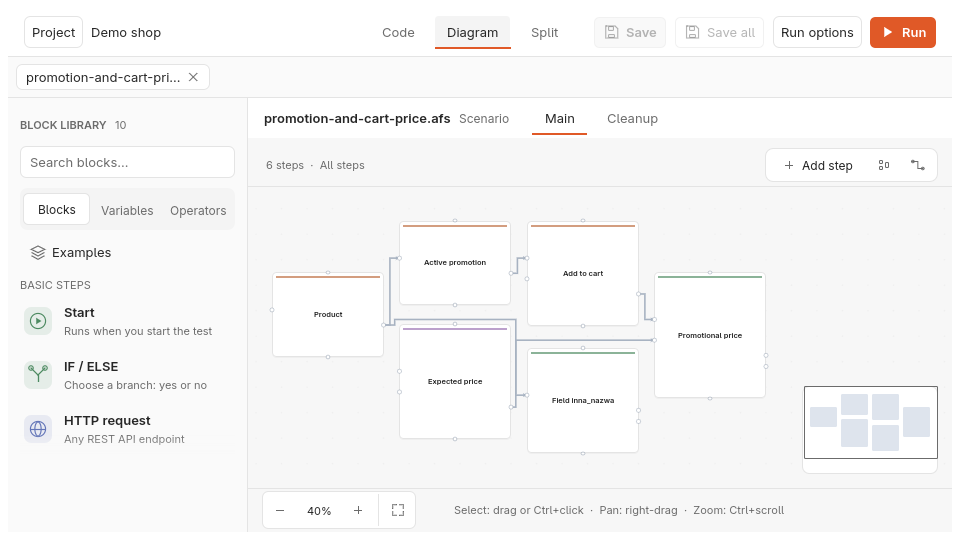
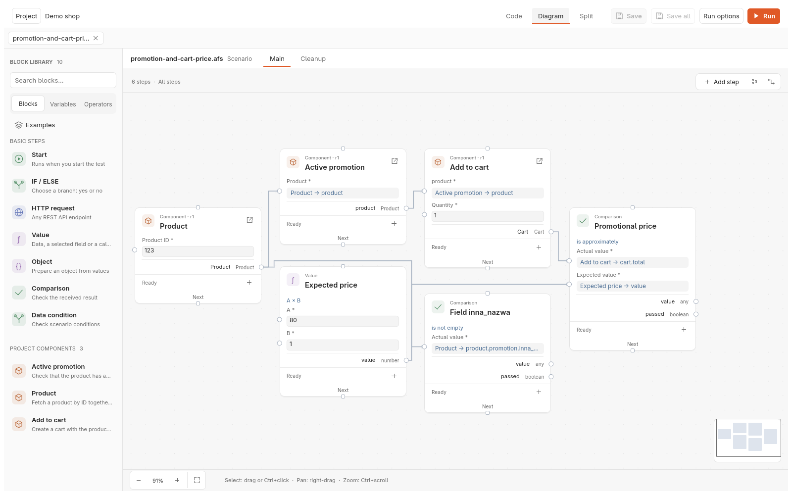
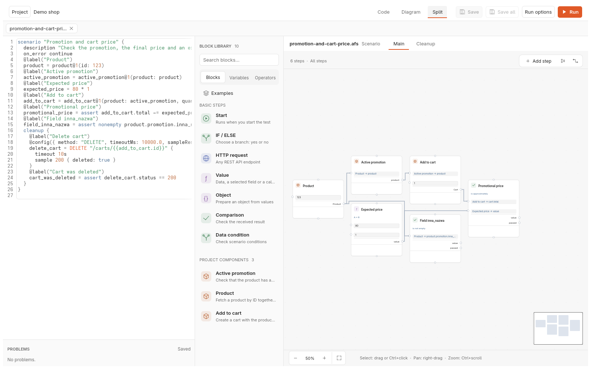
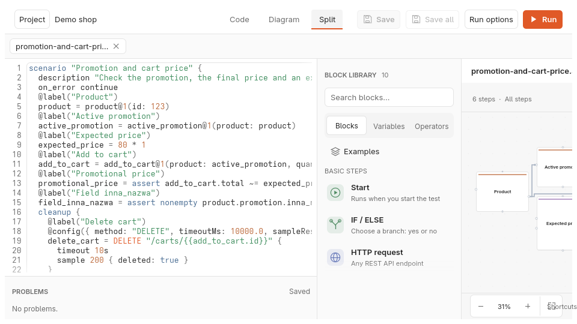
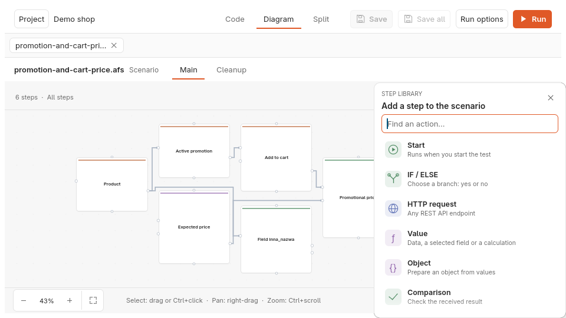

# KTLO-05a: Block library beside the board in the folder mode

- Size: S (analysis) · Owner review: 20 min · Risk: `visible UI`
- State: Approved 2026-10-25 — option A; the *Examples* entry is left out of
  the folder panel; scenario navigation in Diagram mode is a separate ticket
  after KTLO. KTLO-05b implements the acceptance criteria below
- Analysis model: Fable · Implementation model: — (KTLO-05b: Opus 5.5)
- Mock-up branch: `mock/ktlo-05a-library` (throwaway; deleted after the decision)

## Goal

Working on the diagram in a folder project should feel like it did in the
previous window: the blocks, variables and operators are in view beside the
board, can be searched, and can be clicked or dragged onto the board.

## What the owner will see

- **New:** a *Block library* panel to the left of the board in Diagram mode,
  with search, the Blocks / Variables / Operators sections and the project's
  components. In Split mode the same panel appears between the code and the
  board when the window is at least 1440 px wide — the width at which Split
  already shows the inspector.
- **Changed:** in Split below 1440 px there is no room for a fourth panel
  (the mock-up below leaves the board 190 px wide), so the existing *Add
  step* popup is the library there. It already has search and the basic
  steps; it gains the Variables and Operators sections.
- **Removed or hidden:** nothing. *Add step* and the `+` on each card stay.
- **Migrated or converted:** nothing.
- **Default behaviour that changes:** Diagram mode opens with the panel
  visible. Its width is remembered per project like the other panels.

## Mock-up

Captures of the throwaway branch, taken through the design review harness;
the panel is the legacy library's block section placed in the folder window,
unstyled beyond what the legacy window already had.

| View | Capture |
| --- | --- |
| Diagram, 960 × 540 — the panel beside the board |  |
| Diagram, 1600 × 1000 |  |
| Split, 1600 × 1000 — code, library, board |  |
| Split, 960 × 540 — **rejected**: the board shrinks to 190 px |  |
| Today's *Add step* popup, for comparison |  |

## Decisions for the owner

1. **Panel or popup?**
   - **A (recommended):** the panel in Diagram and in wide Split, the popup
     below 1440 px in Split. Restores the previous way of working, including
     drag-and-drop; one more panel to keep tidy.
   - **B:** no panel; extend the *Add step* popup with Variables, Operators
     and drag-and-drop out of the popup. Smallest change, nothing new on
     screen, but the library is hidden behind a click and never in view while
     wiring.
2. **The *Examples* entry.** The legacy library opened two demo scenarios
   into the workspace. In a folder project that would mean writing files into
   the owner's directory. Recommendation: leave it out of the folder panel
   (that is a removal, hence the question).
3. **Not this ticket, but noticed:** Diagram mode has no scenario navigation
   — switching scenarios means the tab strip or Code mode. Recommendation: a
   separate ticket after KTLO; say if it should join KTLO-05b instead.

## Acceptance criteria (for option A)

1. Diagram mode shows a panel named *Block library* left of the board with
   search, the Blocks, Variables and Operators sections and *Project
   components*; every control has an accessible name and the audit in
   `folder/accessibility_tests.rs` passes.
2. Clicking a block adds it at the visible centre of the board, selected; the
   `.afs` source gains its statement and the tab becomes dirty.
3. Dragging a block onto the board adds it at the drop point.
4. An operator chip adds a Value block with that operator; *Variables* lists
   the document's variables and *Add variable* adds one.
5. Split mode shows the panel at 1440 px and wider; below that, *Add step*
   offers the same sections.
6. The panel's width is restored per project with the other panel sizes.
7. When the board is read-only (invalid or held source) the panel is disabled
   with no separate explanation; the board's banner already says why.
8. At 960 × 540 in Diagram every control of the panel, the board toolbar and
   the inspector is inside the window (`assert_within_window`), and
   regression smoke item 3 passes.
9. The empty board's hint reads "Drag a block from the library or add the
   first step" only when the library is in view; otherwise "Add the first
   step".

## Not in scope

Scenario navigation in Diagram mode (see decision 3); keyboard-only block
placement; the *Examples* entry; any restyling of the library beyond what the
folder window's panels already use.

## Estimate for KTLO-05b

M · 45 min owner review · `visible UI`. Option B would be S.

## Technical appendix

- The throwaway branch splits `Library::show` into the navigation part and
  `Library::show_blocks(ui, &Context)`; the mock-up panel is that function in
  `egui::Panel::left("folder-library")` with a `Context` built from
  `context_project()`, `parameters_of(&model)` and the snapshot's
  `editable`. KTLO-05b keeps the split and the panel, drops the static
  switch.
- Drops already work: `canvas/mod.rs` turns a `dnd::Payload::Node` or
  `Payload::Operator` drop into `Command::AddNode` / `Command::AddOperator`,
  and `folder/diagram.rs::board_command` applies both. Click-to-add needs
  the board's visible centre, which the canvas knows (`self.world`).
- `Context.variables` must be filled from the document's graph (variable
  nodes: id and name) for the Variables section; the mock-up leaves it
  empty.
- Panel sizes persist through `workbench.panels` (`documents`,
  `split_code`); add `library`.
- `SPLIT_INSPECTOR_WIDTH` (1440) is the existing Split threshold to reuse.
- The popup is `canvas/menu.rs::ActionMenu`; its `actions()` lists blocks and
  components but not operators or variables.
- The empty-board hint is in `canvas/mod.rs` near "Add an HTTP request".
