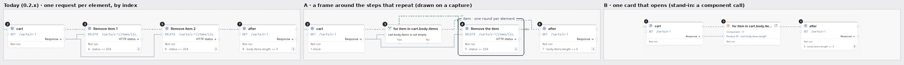

# LANG-16: What a tester cannot write today, and the shape of what is added (LANG-00 part B)

- Date: 2026-11-23 · Analysis model: Fable 5.2
- Issue: [#413](https://github.com/jakubiszon26/apiforge/issues/413) ·
  part B of [LANG-00](LANG-00.md) (#411) · sets the frame for LANG-01 (#127),
  LANG-09 (#353), LANG-08 (#352), LANG-07 (#212), LANG-17 (#470), LANG-02
  (#129), LANG-04 (#132), LANG-19 (#472), LANG-18 (#471), LANG-03 (#131)
- Risk: `format` (new forms in `.afs`), `default` (what a check on a missing
  field reports), `visible UI` (a loop on the board)
- State: **Decided on 2026-11-23.** The owner chose D4 = B, a loop is one
  card that opens, and delegated the other seven
  [decisions](#decisions) and the five [consequences](#confirmed) to an
  independent reviewer (Fable 5.2, not the author of the analysis). The
  shape, the order and the exit criteria below are as decided. LANG-08 owes
  its design-review captures before it is approved; no ticket of the second
  half is `ready:*` yet.
- Measured with `apiforge 0.2.0` built from `main` at `e8e0858e`, simulated.

## Goal

Say what the second half of the LANG sprint builds, from scenarios a tester
wants and cannot write, and in which order; and write the conditions under
which the half is finished.

## Findings

### 1. Measured on `main`

| # | Scenario | Today |
| --- | --- | --- |
| F1 | An answer is 500 with another body; four checks read `status` and three fields of `body.error` | `status` *failed*; the three others **error**, *A value required for the comparison is missing*. One wrong answer is reported as one failure and three defects of the test (LANG-01) |
| F2 | `if` takes a cart id from a list on one branch and creates a cart on the other; the next step reads the id | The step that reads the branch not taken is **blocked**; the one that reads the branch taken runs. A value from "whichever ran" cannot be written; a name inside a branch is already readable after it (LANG-09) |
| F3 | `items contains { sku: "A", qty: 2 }` against elements with four fields | **failed**; passes only when every field of the element is written (LANG-04) |
| F4 | Empty a cart of two items by index, with a third `DELETE` for `items[2]` | the third **errors**, *Missing value for template value 1*: the number of elements must be known when the file is written (LANG-08) |
| F5 | `sample param.status { … }` | *Expected a JSON number*: a sample cannot read anything, so a request written once cannot answer differently per case in a simulation (LANG-17) |
| F6 | Two `sample` lines in one request | *Duplicate request field*: a simulation cannot show a state that changes between two attempts (LANG-07) |
| F7 | `for`, `in`, `repeat`, `until`, `every`, `some`, `none`, `matches`, `table`, `each`, `retry` as handles | all accepted; `??` is *Expected an identifier*. Reserving a word would make a valid file invalid; one test source uses `retry` as a handle (`lay30.rs:183`), no `.afs` of the repository uses any |
| F8 | `labels` (FIX-01): 16 requests, 33 checks, 142 lines | 15 requests repeat two headers; 96 lines are requests that differ in one value; 33 lines are checks with invented names; 11 cases expect exact values, 5 a text that *contains* a parameter |

### 2. Read in the code

- **A step runs once.** The engine removes every node once and keys results by
  node (`engine.rs:543-631`, `Context.outputs`); a result has `node_id` and
  `handle`, no round or attempt (`run.rs:290`). A component call already runs
  a graph inside a step and reports it as `children` (`engine.rs:1033-1074`):
  a round of a loop fits that place, with a round number added to the result.
- **Every statement has a handle**, in the tree and in the model
  (`ast.rs:156`, `format.rs:244`); positions, folded checks and MCP results
  find a statement by it (`reconcile.rs:29-60`, `checks_here.rs:13`,
  `tools.rs:674`). No hidden handle exists. An unnamed check needs one that is
  not written and does not move when a neighbour is edited.
- **Braces are not stored**; a branch is read back from ordering edges
  (`core/branches.rs`, `plan.rs:69-110`). The board draws no frame around a
  branch; LAY-13 (bands) is not built.
- **Shared headers have no place today**: the project holds a base URL,
  variables and secret names only (`format.rs:338`).
- `exists` and `nonempty` already read a missing path as "no"; every other
  predicate returns *missing value*, which the engine reports as *error*
  (`predicate.rs:53-73`, `engine.rs:785-790`).

### 3. The corpus

Twenty scenarios, each the test a tester wants. "Needs" names the smallest
addition that writes it.

| # | The test | Today | Needs |
| --- | --- | --- | --- |
| 1 | Empty a cart: remove every item it holds | by index, F4 | `for` |
| 2 | *Label validation*: one request, 16 cases | 142 lines by copying, F8 | `for` over a table, sample from the row |
| 3 | Wait until an order is *shipped* | not possible: the next `GET` sees the old state | `retry until` |
| 4 | Fulfilment: reserve → pick → pack → ship, each legal only after the state before | not possible | `retry until`, four times, or inside a `for` |
| 5 | Create five products, check the list, remove them | five copies; cleanup by five names | `for`, `collect` |
| 6 | The same, failing at the third: remove what was made | works for a number written out (RUN-01, M5) | `collect` holds what exists |
| 7 | Pages by number: no page above the limit, the total adds up | one request per page, written out | `for` over `range`, `collect` |
| 8 | Pages by cursor: follow `next` until there is none | not possible | **a round that reads the round before: left out by D1** |
| 9 | Every item has a price above 0 and a currency | by index | `every` |
| 10 | The order contains an item with `sku: "A"`, `qty: 2` | all fields written, F3 | `matches` in `some` |
| 11 | Take the element of `included` whose `type` is `items` | `included[0]`, when the API can be asked to order it | `first … where` |
| 12 | A list has no duplicates and is sorted by date | not possible | functions, LANG-02 |
| 13 | Use the customer's cart, or create one | a second `GET` after the `if`, F2 | `??` |
| 14 | An unexpected 500 fails the checks; it does not break them | F1 | a check on a missing field fails |
| 15 | `discount` may be absent; then it counts as 0 | an `if` around the check | `??` |
| 16 | For every order, for every item: stock is not negative | not possible | `for` in `for`, `if` inside |
| 17 | One token and one `Content-Type` for 15 of 16 requests; one without | written 15 times, F8 | shared headers |
| 18 | An e-mail is found whatever its case | two parameters | `lower`, LANG-03 |
| 19 | A request refused with 429 is sent again until 201 | not possible | `retry until` |
| 20 | One component run for each row of data (RUN-02 #130) | one call per row | `for` with a call inside |

The issue asks for the corpus as fixtures. They are not committed here: a
file in a spelling that is not decided fails `check`, and a fixture defines
the format. Each scenario becomes a fixture in the acceptance-test commit of
the ticket that makes it writable ([exit criterion 1](#exit-criteria-of-the-second-half)).

### 4. What the corpus says

- **Of seven scenarios that go round until something holds (3, 4, 8, 19 and
  the waits inside 5–7), six repeat one request.** Only cursor paging needs a
  group of steps whose round reads the one before. The plan's "one block
  shape, two conditions" builds the hard case to get the easy one.
- **A table of cases is a loop over rows.** Its only own needs are a
  readable spelling of rows and a sample that reads the row (F5).
- **Three tickets ask for one rule.** A check on a missing field (LANG-01), a
  value from whichever branch ran (LANG-09) and an empty cell of a table
  (LANG-17) are all "this value may not exist".
- **A partial match is one predicate used in three places**: an element of a
  list (LANG-04), a whole answer (LANG-19), a row's expectation (LANG-17).
- **Nothing here needs a file of today to change its meaning.** The half can
  add and leave `languageVersion` at 2 (LANG-00, section 2, rule 1).

## The proposed shape

Illustrations of what was [decided](#decisions). The exact spelling of each
form is set by the analysis of its ticket.

**A block** is one statement, `handle = head { statements }`, with one way in
and one way out, as `if` is. Its steps run in the order written; blocks nest;
handles stay unique in the file. On the board a loop is **one card that
opens** (D4 = B): its steps are seen inside it, as a component's are.

```text
emptied = for item in cart.body.items {
  drop = DELETE "/carts/{{cart.body.id}}/items/{{item.id}}" {
    sample 204 {}
  }
  assert drop.status == 204
}
```

- The list is read once, on entry; rounds run one after another in its order;
  no element is zero rounds and is not a failure; a value that is not a list
  is an error. Under `on_error continue` a failed round does not stop the
  next (RUN-01's rules hold inside a round).
- `item` and the names written inside are readable inside the braces only.
  What leaves is said: `collect ids = made.body.id` gives `emptied.ids`, a
  list with one value per round that produced it; `emptied.count` is the
  number of rounds. These are the card's outputs, as exports are a
  component call's.
- The steps inside read values from outside as a branch's do
  (`cart.body.id` above); nothing is declared. The card shows each as an
  input.
- A run reports each round under the loop, named by the row's first text
  value or its number, as a component call's steps are reported today. The
  closed card and the run's summary name the rounds that failed (*3 of 16
  cases failed: Weight 31 kg, …*).

**Waiting** is said on the request that is repeated:

```text
order = GET "/orders/{{placed.body.id}}" {
  retry until order.body.state == "shipped" within 5s every 200ms
  sample 200 { state: "packing" }
  sample 200 { state: "shipped" }
}
```

After it `order` is the last answer; the step fails when the time passes and
says how many attempts it made. A simulation waits for nothing and answers
attempt *n* with the *n*-th sample, the last one repeating. A `retry` is a
field of its request: the request stays one card, with no card of its own.

**A table** is a value: a list of rows, written as rows. It is a statement
of its own, so it is a card on the board and its cases are read without
opening the loop. A cell is a literal; an empty cell is a value that does
not exist. A loop reads it by its name, as it reads any list:

```text
cases = table {
  | name            | weight | postcode | status | error                                      |
  | "Weight 31 kg"  | 31     | "00-950" | 422    | { code: "out_of_range", field: "weight" }  |
  | "No postcode"   | 2      |          | 422    | { code: "postcode_required" }              |
}
refused = for case in cases {
  sent = POST "/parcels/{{param.parcel_id}}/labels" {
    body { weight: case.weight, postcode: case.postcode, service: "standard" }
    sample case.status { error: case.error }
  }
  assert sent matches { status: case.status, body: { error: case.error } }
}
```

`labels` written this way is 16 rows in two tables (11 exact, 5 *contains*)
and two requests: about 45 lines for 142, and a seventeenth case is one row.
The row *No postcode* needs a field without a value to be left out of the
body, which is HTTP-01 (#128), outside this sprint ([proposal P1](#proposals-beyond-the-request)).

**A value that may not exist**: `a ?? b` is `a` when it exists, otherwise
`b` (`cart_id = found ?? made.body.id`; `discount = cart.body.discount ?? 0`).
A check that reads a missing field of an answer that came **fails** and says
the field is missing; only `exists` answers "no" without failing.

**Checks**: `assert` without a handle where nothing reads the result;
`x matches { … }` compares the fields written and ignores the rest, and
when it fails names every field that differs;
`every item in list { … }` and `some item in list { … }` are predicates with
the loop's `name in list`.

**Shared headers** are written once, `headers { … }` in the scenario's
head; a request's own entry wins. How a request leaves one out is LANG-18's
to spell: `Name: none` is not confirmed, because a value is read by its bare
handle and `none` can be one today.

## The picture on the board



First round, [form 2 and 3 of the mock-up rules](../process/planning.md#mock-ups):
a loop exists in no build. The cards are the application's, captured from the
real window at 1600 × 1000 (`today-1600.png`, `stand-in-if-1600.png` beside
the board). In **A** the head is today's `if` card with a label, its *Yes/No*
row would not be there, and the frame is drawn on the capture. In **B** the
card is a component call with a label. LANG-08's own analysis owes the
design-review captures at 960 × 540 and 1600 × 1000, and with them the loop
in Run results and in *Steps* (REQ-01), before it is approved.

The owner chose **B** on this board (2026-11-23). What LANG-08's captures
have to show because of it: the card closed, with its inputs, `count` and
its collected lists, and with the rounds that failed after a run; the card
open, and the way back; a loop inside a loop; the table's card beside it. A
component opens as another document (`inspector/mod.rs:471`); a loop's
steps are in the same file, so the view of a part of a document is new.

- **A · a frame.** The steps that repeat stay on the board, in the chain,
  inside a frame that carries the loop's variable; the same picture LAY-13
  decided for a branch (a band per pair of braces). Editing inside is the
  placement rule of DIAG-06a with one more kind of braces.
- **B · one card.** The loop is one card that opens, as a component does. The
  board is shorter; what repeats is not visible without opening, and a step
  is added to a loop in another place than to a branch.

## Decisions

D4 is the owner's (quiz, 2026-11-23). The others were decided the same day
by an independent reviewer on the owner's delegation; the ruling is on
[#413](https://github.com/jakubiszon26/apiforge/issues/413#issuecomment-7103075273).
*Rec.* is the option the analysis recommended. D5–D8 are directions: each
comes back with its ticket's analysis for the exact spelling only.

| # | Question | Decided | Rec. | Reason |
| --- | --- | --- | --- | --- |
| D1 | What repeats | **A** `for` as a block, and `retry until` on one request; cursor paging stays out | A | Six of the seven scenarios that go round until something holds repeat one request. As a block a wait would be a card hiding one request; as a field it stays that request's card |
| D2 | What a loop gives back | **A** names stay inside; `collect name = expr` gives a list; `count` | A | What a component call does: the runner copies the inner graph's exports onto the calling step and nothing else leaves (`engine.rs:1058-1072`). With one card, a name read after the loop would be a wire from a step that is not seen |
| D3 | A table of cases | **A, as a variant**: the `table { \| … \| }` spelling in the `.afs`, as a value of its own read by `for case in cases`; not inside the loop's head. Cells are literals | A, inside the head | A value statement is a card already, so the cases stay readable while the loop is closed; the head keeps one pair of braces. A list written as JSON needs nothing more: `for` takes any list |
| D4 | A loop on the board | **B** one card that opens — **the owner** | A | — |
| D5 | A check that reads a missing field | **A** it fails and names the field; `??` says what stands in | A | F1. Only `exists` and `nonempty` read a missing value as "no" today (`predicate.rs:53-73`); an *error* sends a tester to look for a defect in the test. A value whose step never ran stays *blocked* (ADR 0015); a missing value in a URL or a body stays an error |
| D6 | A check without a name | **A** allowed where nothing reads it, built after `matches` | A, before `matches` | The predicate is already a check's title on its card and in Run results (REQ decisions 1–3), and no AB-01 driver chose a check's name. Every position, folded check and MCP result finds a statement by its handle, so it is the riskiest change of the half: tables and `matches` remove most invented names first, and it is the ticket to drop if the half runs long |
| D7 | One check for several fields | **A** `matches { … }` | A | `condition all { … }` is a list of predicates already; a partial object is what F3 lacks. A failed `matches` names every field that differs |
| D8 | Headers shared by a scenario | **A** `headers { … }` in the scenario's head; a request's own entry wins. The spelling of leaving one out is LANG-18's, and not `none` unless it is shown to be an error today | A, with `Name: none` | The file holds all a run uses; a header in the project would change every scenario unseen (`format.rs:338`). `limit = 10` is read as `limit`, so a bare `none` can be a reference in a valid file |

Not chosen: D1 B and C; D2 B and C; D3 B as the only spelling, C and D;
D4 A; D5 B; D6 B; D7 B and C; D8 B and C.

## Confirmed

1. **The language version stays 2**, and no word is reserved. Every new form
   is an error today at the place it stands (`x = for a in …`,
   `collect a = …`, `a matches {`, `x = table {`, `retry until` among a
   request's fields), so no valid file changes its meaning (F7). The
   acceptance tests of each ticket keep a file that uses its new words as
   handles.
2. **`sample` may read the loop's row, and a request under `retry` may carry
   several samples** (F5, F6). A sample reads the row and literals, never
   another step; elsewhere both stay errors.
3. **A table lives in the `.afs`.** Rows from a file beside it are RUN-02
   (#130), after the sprint.
4. **Every loop and every `retry` has a ceiling that ends it as a failure**,
   as a timeout is at most 60 s and component calls nest to 16
   (`request.rs:116`). The numbers are set by LANG-08 and LANG-07 with their
   measurements.
5. **LANG-07 is analysed beside LANG-08**, not inside it. With D4 = B a
   `retry` has no card of its own and shares no board work with the loop.

## The proposed order

| Order | Ticket | Delivers | Size, provisional |
| --- | --- | --- | --- |
| 1 | LANG-01 #127 with LANG-09 #353 | a check on a missing field fails; `??` | M · 20 · `default`, `format` |
| 2 | LANG-08 #352, in two: **a** the `for` block, rounds in the run and the failed rounds named, the card that opens · **b** `collect` | scenarios 1, 16, 20; then 5–7 | a: above M as one ticket; its analysis splits it, text and run first, the board second · `format`, `visible UI` · b: S · 10 · `format`, `visible UI` (outputs on the card) |
| 2 | LANG-07 #212, beside 08a | `retry until`; scenarios 3, 4, 19 | M · 20 · `format`, `visible UI` (attempts in Run results, a mark on the request's card) |
| 3 | LANG-17 #470, after 08a | the table as a value and its card, the sample from a row; `labels` rewritten | M · 20 · `format`, `visible UI` |
| 4 | LANG-19b #472 with LANG-04 #132 and LANG-02 #129: `matches`, `every`, `some`, `first … where` | scenarios 9–12 | M · 20 · `format`; LANG-02's functions (unique, sorted) S after |
| 5 | LANG-19a #472 a check without a name | the invented names that tables and `matches` leave | M · 20 · `format`, `visible UI`; the ticket to drop if the half runs long |
| 6 | LANG-18 #471 | shared headers; scenario 17; unblocks REQ-09's header half | M · 20 · `format`, `visible UI` |
| 7 | LANG-03 #131 | text functions; scenario 18 | S · 10 |

The milestone's order stands, with four changes. LANG-07 leaves LANG-08's
analysis (D1). LANG-08 and LANG-19 are each two tickets, and `matches` comes
before the unnamed check (D6): it carries corpus scenarios and no risk to a
statement's identity. LANG-17 follows the loop instead of sharing its
ticket. LANG-08a is larger than the analysis sized it, because D4 = B needs
a view of a part of a document, which the window does not have; if it is
split, a build that reads a loop also draws its card, so no merged build
opens a file it cannot show. The sizes are provisional and LANG-08a's is
open; the 190 owner minutes of the analysis no longer hold. Rows 1, 2 and 4
touch different files (`predicate.rs` and the parser's operators; the
engine and `canvas/`; the predicates) and can be analysed side by side;
REQ's tickets in `canvas/` are not open together with LANG-08a.

Analyses that can start now: LANG-01 with LANG-09, LANG-08, LANG-07. None
is `ready:*` by this ticket. After its analysis LANG-03 could take
`ready:opus` directly; LANG-01 with LANG-09, LANG-08b, LANG-19b and LANG-07
could once their spellings are approved; LANG-08a, LANG-17, LANG-19a and
LANG-18 wait for their captures.

## Exit criteria of the second half

- [ ] Each of the twenty scenarios of the corpus is a fixture under
      `fixtures/scenarios/lang/`, passes `check`, prints unchanged and gives
      the same simulated report through the command line and the MCP server;
      scenario 8, and any other the decisions leave out, is named in
      the reference under *What cannot be expressed*.
- [ ] `labels` is written with every case once: a seventeenth case is one
      added row; its run reports 16 cases by name and checks the same 33
      expectations as on `e8e0858e`: breaking any one of them fails its
      case and names the field.
- [ ] Every `.afs` of the repository as of 0.2.1 passes `check` unedited and
      its simulated run has the same verdict per step, except the errors D5
      turns into failures, which are listed in the pull request that does it.
- [ ] F1 reports one failure per check and no error.
- [ ] A run with a loop is the same twice; each round can be told apart in
      Run results, in `run --json` and in the MCP answer; under `on_error
      continue` a failed round does not keep the next from running.
- [ ] A simulated `retry` takes no time; a live one ends within its limit and
      reports its attempts.
- [ ] No gesture on the board writes a file that does not pass `check`, with
      a loop on it, closed or open. A step can be added to, moved inside and
      removed from an open loop, and every step of a file with a loop can be
      reached from the board.
- [ ] After a run a closed loop's card says how many rounds failed and
      names them; the table of `labels` is read on the board without opening
      the loop.
- [ ] The reference describes each new form with an example its test parses
      and runs; ADR 0005 and ADR 0015 are amended by the tickets that change
      them.

## Compared on the corpus

| Need | Karate | Bruno | A classical framework (pytest) | Proposed, and why |
| --- | --- | --- | --- | --- |
| A table of cases | `Scenario Outline` with `Examples:` | a CSV or JSON file given to the runner | `parametrize` | the table, taken from Karate: rows read at a glance. In the file, not beside it: a file holds all a run uses |
| For each element | a call with a list, or JavaScript | JavaScript and `setNextRequest` | `for` | a block: no second language in a file an agent and the board both edit |
| Wait for a state | `retry until` before the request | JavaScript | a polling helper | Karate's form, on the request; the limit is written at the place, not configured elsewhere |
| A partial match | `match contains`, `match each` | `assert { }` with operators, by path | `assert` | `matches`, `every`, `some`: Karate's markers inside values (`#string`, `##`) are not copied, a type check is already `is` |
| A missing field | `#notpresent`, `##` | `isUndefined` | an exception | fails as a check; one operator, `??` |
| Shared headers | `configure headers` | collection and folder settings | a session fixture | in the scenario's head: visible in the file that is run |
| Cleanup | `afterScenario` hook | none | a fixture's teardown | exists; a loop in it reads what `collect` holds |

## Not in scope

Cursor paging and any loop whose round reads the round before (candidate
below). Rows from a data file (RUN-02 #130). Running rounds side by side:
the loop is one node with one way in and out, so LANG-00's room for it
stays. The loop in Run results and *Steps*: LANG-08's mock-ups. User
functions, imports.

## Proposals beyond the request

P1, P2 and P4 are offers of scope, open for the owner; none holds a ticket
of the half back.

| # | Proposal | Solves | Size, risk | Trade-offs | Where |
| --- | --- | --- | --- | --- | --- |
| P1 | **A field, header or query entry whose value does not exist is not sent** (HTTP-01 #128 and HTTP-02 #133 as one rule) | the row "no postcode field" and "no token" of a table; one component for variants of a request | M · 20 · `default` | today such a step errors, which catches a typing mistake in a name; the rule would hide it unless only `??`-free optional inputs and empty cells count | with LANG-17, this sprint |
| P2 | **`apiforge fix` offers the table**: requests that differ only in literal values become rows | the 16 edits of `labels`, and every scenario written by copying before the table existed | M · 20 · `format` | a fix that rewrites many statements must show a difference a person can read; not automatic | after LANG-17; REQ-09's third hint |
| P3 | **A run names the case that failed first**: the summary of a failed loop says *3 of 16 cases failed: Weight 31 kg, …* in the window, the command line and MCP | finding the row is the reason a table is worth having | S · 10 · `visible UI` | none found | **part of LANG-08a** since D4 = B: a closed card has to say what failed inside |
| P4 | **A loop that reads its last round** (`repeat`, cursor paging, scenario 8) | the one corpus scenario left out | M upper end · `format` | a second kind of loop and a rule for "the round before" | later; a candidate issue, since D1 = A |
| P5 | **The frame for a branch too** (LAY-13) built with the loop's | one picture for every pair of braces, one implementation | S on top of LANG-08a | LAY-13 was moved after 0.2.0 by the owner; this pulls it back | **lapsed** with D4 = B: no frame is built; LAY-13 stays where the owner put it |

## Technical appendix

- Rounds: a nested `execute_graph` per round with the row bound, results as
  `children` with a round index added to `StepResult` (`run.rs`), which the
  report, `run --json` and MCP `Step` carry; `fixtures/runs` grows, existing
  files unchanged.
- With D4 = B the body is a graph inside the loop's node, run as a
  component's is (`engine.rs:1033-1074`), not a third kind of braces read
  back from edges. A component's graph starts from its parameters alone
  (`Context.outputs` is empty there), so what the body reads from outside
  reaches a round as the loop node's inputs, which is also what the card
  draws. `collect` is the body's export, gathered per round. LANG-08
  decides how the model holds the inner graph.
- The table: `|` is a symbol of the lexer already, and `||` is one token
  (`lexer.rs:108-116`); two empty cells written without a space meet it.
  LANG-17 reads `||` inside a table as two bars and the formatter prints the
  space.
- `??` and `retry`: the lexer has `?` as the empty slot; `??` is a new
  two-character token (`lexer.rs:108-116`).
- An unnamed check: a handle derived from its step and predicate, kept by
  `reconcile` as a rename is; never printed. Its collision and edit rules are
  LANG-19a's analysis.
- Shared headers: merged in lowering into each request's `headers` slot, so
  the runner, redaction and Run results see a request as today, with the
  origin of each entry kept for the view.
